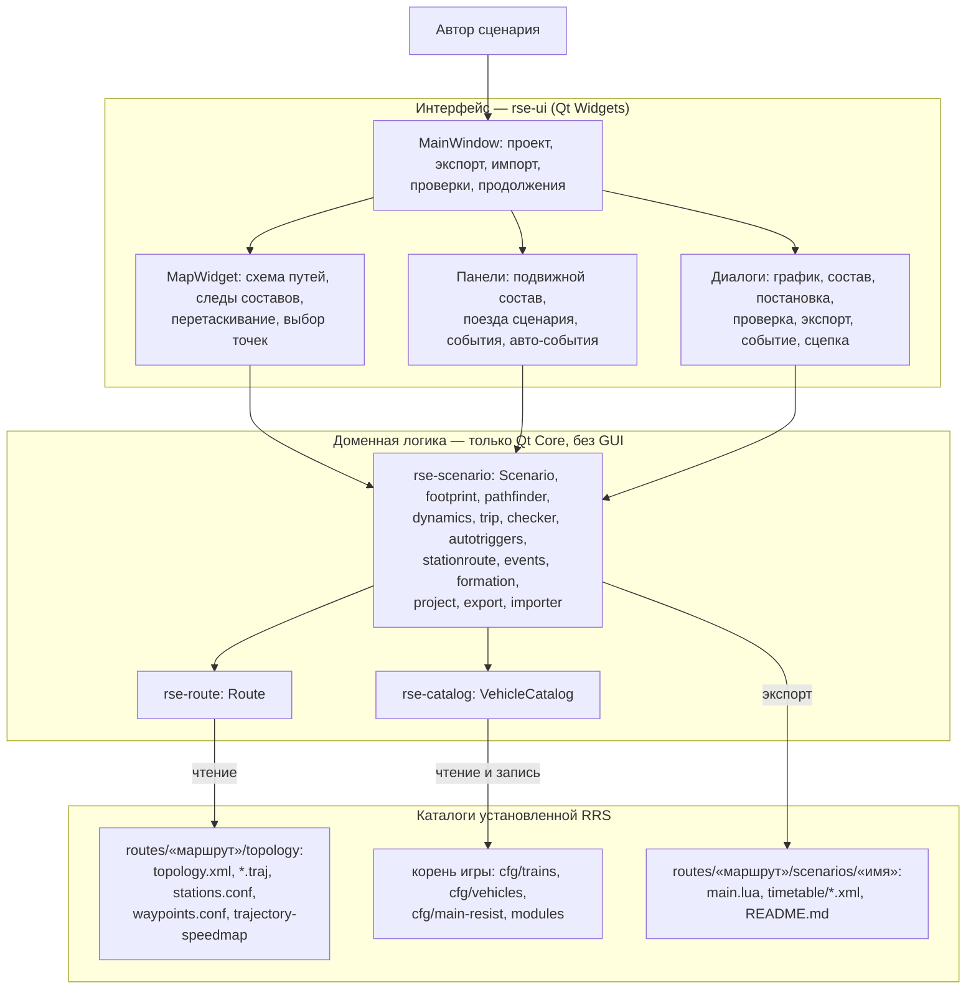
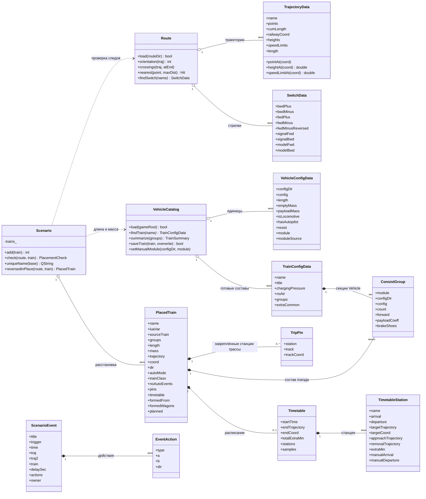
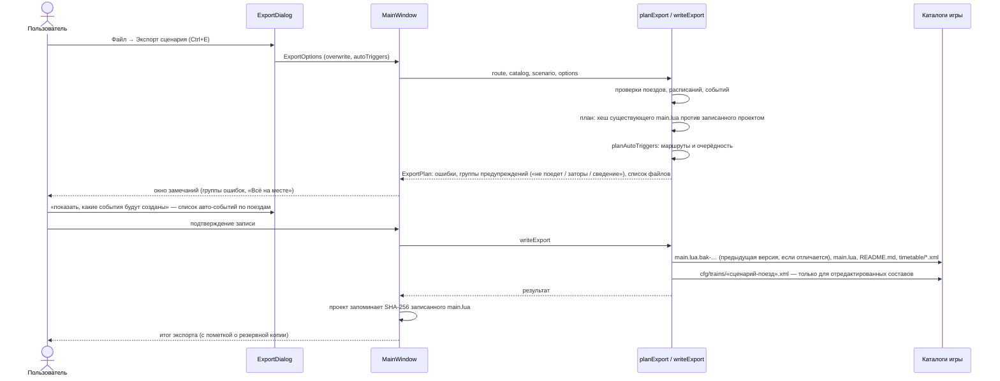

# Редактор сценариев RRS — техническая документация

> **Статус кода:** этап 19 («Пакет 2: „сначала" — видимость того, что уйдёт в игру»), версия 0.1.0.
> **Целевой симулятор:** [RRS — Russian Railway Simulator](https://github.com/maisvendoo/RRS), **целевая версия — v1.9.4** (зафиксировано автором проекта); ветка разработки `v1.10.0-devel` отслеживается на предмет изменений API.
> Документ отражает состояние проекта на ноябрь 2026 г. и построен на полном анализе исходников редактора (~20,6 тыс. строк `src` + ~5,8 тыс. строк тестов) и официальной документации симулятора `docs/ScenarioAPI`.

## Содержание

1. [Назначение и границы проекта](#1-назначение-и-границы-проекта)
2. [Термины и обозначения](#2-термины-и-обозначения)
3. [Архитектура](#3-архитектура)
4. [Интеграция с RRS](#4-интеграция-с-rrs)
5. [План развития](#5-план-развития)
6. [Открытые вопросы](#6-открытые-вопросы)

---

## 1. Назначение и границы проекта

Редактор сценариев — это отдельное настольное приложение (C++17, Qt 6, CMake), которое автоматизирует подготовку сценариев для симулятора RRS. В RRS сценарий является Lua-программой в каталоге маршрута, и вручную его писать неудобно: автору нужно помнить имена сотен траекторий и стрелок, считать координаты постановки составов, следить за непересечением графиков движения и согласовывать поля XML-расписаний с логикой автопилота. Редактор закрывает именно этот участок работы: он визуализирует схему путей маршрута, позволяет расставлять поезда мышью, рассчитывает графики хода и сам генерирует файлы сценария в формате, который симулятор загружает без правок.

Проект не является частью репозитория RRS и не заимствует его исходный код: редактор только читает файлы маршрута и каталога игры (тот же формат данных, что и у симулятора) и записывает сценарии в каталоги, ожидаемые движком. Лицензия редактора — GPL-2.0, как у RRS (решение автора).

Ключевые возможности текущей версии:

- **Чтение маршрута** — траектории `*.traj`, стрелки `topology.xml`, станции `stations.conf`, путевые точки `waypoints.conf`, ограничения скорости `trajectory-speedmap`; вывод правильного направления путей по светофорам.
- **Каталог подвижного состава** — единицы `cfg/vehicles`, готовые составы `cfg/trains`, привязка конфигов к модулям `modules`, создание и правка составов прямо в игре.
- **Расстановка поездов** — постановка по карте с «призраком», перетаскивание, разворот на месте, след через стрелки, разбиение состава на части, продолжения (сцепка локомотива с вагонами), будущие (planned) поезда.
- **Графики движения** — расчёт хода по физике (сопротивление, уклоны, ограничения скорости), станции и стоянки, запасы времени, выбор пути станции, проверка графиков на пересечения и заторы; столбец «Маршрут» в окне графика показывает, какие светофоры откроет автопилот и когда, с подсветкой их на карте.
- **События** — ручные триггеры/действия и автоматические события маршрутов по расписаниям; для поездов без
  автоведения эти события обязательны (RRS загружает timetable только в компоненты Autopilot),
  а флажок экспорта включает дополнительную обработку поездов с автоведением и очерёдность по
  категориям поездов; панель «События по графикам (авто)» показывает их до экспорта (группировка по поездам и станциям, подсветка маршрута по клику, отключение по поезду).
- **Импорт и экспорт** — чтение существующих сценариев (с сохранением нераспознанного Lua как есть) и запись `main.lua`, `timetable/*.xml`, `README.md`, новых составов в `cfg/trains`; предупреждения экспорта сгруппированы по важности, ручные правки `main.lua` защищены хешем в проекте и резервной копией при замене.
- **Проект редактора** — файл `.rrsproj` (JSON) со всей расстановкой, расписаниями и событиями.

Редактор сознательно не делает того, что умеет сам симулятор: он не запускает физику в реальном времени и не рендерит 3D-сцену. Все расчёты — «оценочные» (ход поезда, проверка пересечений), их роль — вовремя предупредить автора сценария, а не заменить симуляцию. Это осознанный компромисс, отражённый и в тестах: расчётные проверки проверяются на синтетическом маршруте, а полнота — на живых данных маршрута «Испытательный полигон 2.0» через опцию сборки `RRS_ROUTE_DIR`.

## 2. Термины и обозначения

В коде и документе используются термины, соответствующие лексике симулятора. Русский термин и англоязычный эквивалент даются так, как они встречаются в исходниках RRS и редактора.

| Термин (EN) | Определение |
|---|---|
| Траектория (trajectory) | Непрерывный участок пути между стрелками; файл `topology/trajectories/<имя>.traj` — полилиния из точек `x y z`. Единица маршрутизации и занятости в движке RRS. |
| Стрелка (switch / connector) | Узел соединения траекторий, секция `<Switch>` в `topology.xml`: `bwdPlusTraj`, `bwdMinusTraj`, `fwdPlusTraj`, `fwdMinusTraj`, `fwdMinusTrajReversed`. Может нести светофоры. |
| Светофор (signal) | Сигнал, привязанный к стрелке; тип определяется суффиксом модели (`line` — проходной, `entr` — входной, `rout` — маршрутный, `exit` — выходной, `shnt` — маневровый). Литера задаётся в `SignalLiterFwd/Bwd`. |
| Правильное направление (orientation) | Выводимое редактором направление «туда» (+1) / «обратно» (−1) по траектории; на неправильном пути поездные светофоры по ходу не открываются. |
| След состава (footprint) | Перечень участков траекторий, занятых составом от головы к хвосту, с проверками тупика и неоднозначных стрелок. |
| Состав (consist) | Группы единиц подвижного состава (секция `<Vehicle>` конфига поезда). |
| Готовый состав (train config) | Файл `cfg/trains/<имя>.xml`, на который сценарий ссылается через `TrainData.config`. |
| Единица (vehicle) | Отдельный локомотив или вагон; конфиг `cfg/vehicles/<каталог>/<имя>.xml`. |
| Модуль (module) | Динамическая библиотека `modules/<каталог>/<модуль>`, реализующая физику единицы. |
| График (timetable) | Расписание движения поезда, файл `timetable/<имя поезда>.xml` в каталоге сценария. |
| Расстановка (placement) | Поезд, стоящий на путях в начале сценария: класс `PlacedTrain` редактора. |
| Событие (event) | Триггер + список действий; записывается в `main.lua`. |
| Автотриггеры (auto triggers) | События маршрутов, которые редактор генерирует по расписаниям; в `main.lua` лежат между маркерами `-- [rse-auto begin]` / `-- [rse-auto end]`. |
| Подход / уход (approach / removal) | Траектории перед и после траектории станции; по ним автопилот строит маршруты приёма и отправления. |
| Продолжение (continuation, formation) | Поезд, который возникает в игре после сцепки локомотива с вагонами: `renameTrain` + `reverseTrain`, `setTrain` для него не пишется. |
| Будущий поезд (planned train) | Поезд, которого в начале сценария нет; в сценарий попадает только его `timetable/<имя>.xml`. |
| Категория поезда (train class) | Редакторская категория очерёдности (скорый → пассажирский → пригородный → грузовой → резервом); движком RRS не используется, реализуется триггерами. |
| Корень игры (game root) | Каталог установленной RRS с подкаталогами `cfg`, `modules`, `routes`. |

---

## 3. Архитектура

### 3.1 Блок-схема

Приложение разбито на четыре статические библиотеки и исполняемый файл. Жёсткое правило, закреплённое в `CMakeLists.txt`: доменные библиотеки (`rse-route`, `rse-catalog`, `rse-scenario`) зависят только от Qt Core и не знают о графическом интерфейсе. Это позволяет тестировать всю логику без дисплея (`QT_QPA_PLATFORM=offscreen`) и в перспективе переиспользовать её в CLI-инструментах.



Поток управления направлен строго сверху вниз: интерфейс вызывает функции доменных библиотек и отображает их результаты; никаких обратных вызовов из домена в GUI нет — домен возвращает структуры данных (`PathResult`, `TripResult`, `ExportPlan`, `ImportResult`), а окна сами решают, как их показать. Точка входа `main.cpp` минимальна: она создаёт `MainWindow` и, если передан аргумент командной строки, сразу открывает маршрут.

### 3.2 Модули сборки

| Модуль | Объём (строк) | Зависимости | Ответственность |
|---|---|---|---|
| `rse-route` | ~1,6 тыс. | Qt Core | Чтение и индексация маршрута: траектории с накопленной длиной в 3D, стрелки и их примыкания, станции, путевые точки, ограничения скорости; вывод правильных направлений; поиск ближайшей траектории; замечания о битых ссылках. |
| `rse-catalog` | ~1,6 тыс. | Qt Core | Каталог ПС игры: единицы, готовые составы, модули; вывод привязки «конфиг → модуль» по готовым составам; сохранение составов; ручные привязки в `vehicle-modules.json`. |
| `rse-scenario` | ~8,6 тыс. | `rse-route`, `rse-catalog` | Вся предметная логика: следы и проверки расстановки, поиск пути, физика хода, графики, проверка расписаний, авто-триггеры, станционные маршруты, события, проект, импорт и экспорт. |
| `rse-ui` | ~10,2 тыс. | все выше + Qt Widgets | Главное окно, карта, панели и диалоги; диалоги не хранят состояние сценария — всё живёт в `MainWindow` (`route_`, `catalog_`, `scenario_`, `project_info_`). |
| приложение | 27 | `rse-ui` | `main.cpp`: точка входа, опциональный аргумент — каталог маршрута. |
| тесты | ~5,4 тыс. | соответствующие библиотеки | 13 тестовых исполняемых файлов (см. §3.7). |

### 3.3 Модель данных (UML)

Ключевые классы домена и их связи показаны ниже. Идентификаторы — как в коде (пространство имён `rse`).



Несколько решений модели требуют пояснения:

- **`PlacedTrain` — центральная сущность.** Она объединяет геометрию (голова: `trajectory`, `coord`, `dir`), состав (`groups`), режим (`autoMode`, `trainClass`, `noAutoEvents`) и расписание (`Timetable` с расчётными выборками движения `samples` для проверок). Виртуальные поезда (`planned`, продолжения с `formedFrom`) не стоят на путях и в `main.lua` не выставляются — `isVirtual()` исключает их из `setTrain`.
- **`Timetable.samples`** — расчётные положения головы поезда на общей сетке времени (шаг 10 с). Они же используются проверкой пересечений (`checker`), поэтому график «живёт» вместе с поездом и сбрасывается при изменении положения или состава.
- **`TrainConfigData.extraCommon`** — поля `Common`, которых редактор не знает (`ClientName`, `TrainID`…), сохраняются и записываются обратно, чтобы не портить чужие конфиги.
- **`ScenarioEvent.owner`** отличает авторские события от событий, созданных редактором по расписаниям; вторые при импорте отбрасываются и создаются заново при экспорте.
- **`Route` — только для чтения** и содержит вычисляемые поля: `orientation()` (правильное направление, выведенное из литер светофоров и перенесённое по цепочкам стыков) и `crossings()` (что за концом траектории: тупик, один переход или развилка, положение которой решит игра).

### 3.4 Ключевые алгоритмы

| Алгоритм | Где | Как устроен |
|---|---|---|
| След состава (footprint) | `scenario/footprint` | `walkTrack` проходит от головы назад по траекториям через стрелки, как симулятор при расстановке; отмечает тупик (`deadEnd` + недостающие метры) и стрелки с неоднозначным положением. `overlapLength` считает пересечение следов, `extendedFootprint` расширяет след на зону автосцепки 10 м (`COUPLE_DISTANCE`). |
| Правильное направление | `route.cpp` (`calcPathDirections`) | Направление выводится только по стрелкам с одной заданной литерой (проходные с обеими литерами не дают сигнала); маневровые светофоры игнорируются; литера с «Д» инвертирует направление (выход на неправильный путь). Результат переносится по цепочкам простых стыков. |
| Поиск пути | `scenario/pathfinder` | Два разных алгоритма: `findPath` — для редактора (Дейкстра по метрам с штрафом 3000 м за траекторию против правильного направления); `gameRoute` — как в движке (`Topology::find_route`): поиск в ширину, побеждает маршрут с наименьшим **числом траекторий**, а не длиной. Расхождение двух результатов диагностируется (`firstDivergence`), потому что автопилот игры пойдёт по своему пути. |
| Физика хода | `scenario/dynamics` | Основное сопротивление по `MainResist` каждой единицы: `w = b0 + (b1 + b2·v + b3·v²)/q` (кгс/т); тяга — приближение по мощности и силе трогания (реальная ТХ зашита в код модулей, значения правятся вручную); торможение заранее с замедлением 0,5 м/с² (запас); профиль пути — равномерная сетка 5 м с высотами `.traj` и ограничениями скорости, действующими, пока хвост не проехал участок. |
| График | `scenario/trip` | `computeTrip` строит строки графика: станции по координатам `stations.conf` (с порогом отклонения пути), стоянки и проезды, запас «на весь путь» (по умолчанию 10 % времени хода, не меньше 2 мин, распределяется по перегонам пропорционально) и личный запас «до станции»; времена округляются вверх до минуты. Ручные времена (этап 21а) становятся якорями: строка с ручным прибытием/отправлением идёт в экспорт как введена (без запаса и округления), последующие строки авторасчёта пересчитываются от неё; противоречия (отправление раньше прибытия, прибытие раньше отправления с предыдущей станции) дают предупреждения. `pinToPoint` ставит закреплённой станции («через станцию X», этап 21б) в соответствие точку пути: выбранный путь станции или ближайший к ней. |
| Проверка расписаний | `scenario/checker` | `checkSchedules` прогоняет все `samples` по общей сетке (10 с) и находит ошибки (два поезда на одном месте, встречное движение, отправление раньше начала сценария) и риски (интервал < 30 м, подход к стоящему ближе 10 м, график без бота). Коды проблем (`collision`, `headway`, `head-on`, `before-start`, `no-bot`…) используются и в окне F7, и в предупреждениях экспорта. |
| Автотриггеры | `scenario/autotriggers` | `planAutoTriggers` строит `RouteClaim` — какие траектории занимает маршрут приёма/отправления каждого поезда и в какое окно времени; конфликты «спор за путь» (окно 5 мин) разрешаются по категориям: маршрут младшей категории строится триггером «путь освобождён поездом» после старшей; повторы построения маршрута через 45/120 с или 60/180 с. |
| Станционные маршруты | `scenario/stationroute` | `detectZones` находит станционные зоны вдоль пути по светофорам (входной открывает зону, первый выходной закрывает); `simulateAutopilot` выполняет график «на бумаге» в одном направлении поиска, как автопилот игры, и возвращает `AutopilotReport` (число траекторий маршрута, открываемые светофоры с указанием стрелок — `RouteSignalMark`, проблемы). Метки используются окном графика: столбец «Маршрут» и подсветка светофоров на карте. |
| Продолжение (сцепка) | `scenario/formation` | `planFormation` считает момент готовности (прибытие локомотива + задержка), положение головы продолжения (бывший хвост локомотива) и состав; `exportOrder` возвращает порядок `setTrain` — локомотив раньше вагонов, иначе после сцепки «выживет» поезд с вагонами (семантика движка). |
| Импорт | `scenario/importer` | Лексический разбор `main.lua`: `setTime`, поезда (`TrainData` + `setTrain`), события с подстановкой локальных констант и функций-обёрток; всё нераспознанное сохраняется в `opaquePre` (объявления) / `opaquePost` (остальное) и записывается при экспорте без изменений; имена Lua-переменных поездов сохраняются, чтобы сохранённый код продолжал работать. |
| Экспорт | `scenario/export` | `planExport` ничего не пишет — только проверки и план (какие файлы, какие составы создать); `writeExport` исполняет план. Авто-события кладутся между маркерами `-- [rse-auto begin]` / `-- [rse-auto end]`, при импорте блок между маркерами игнорируется и пересоздаётся. `groupExportWarnings` раскладывает предупреждения по важности («поезд может не поехать» / «возможные заторы» / «для сведения») — одной группировкой пользуются диалог экспорта и тесты. Проект хранит SHA-256 записанного `main.lua`: при повторном экспорте с заменой редактор распознаёт ручные правки, предупреждает о них и сохраняет предыдущую версию рядом (`main.lua.bak-ГГГГММДД-ЧЧММСС`), если новое содержимое отличается. |

### 3.5 Поток экспорта



Разделение «план → запись» — центральное архитектурное решение экспорта: вся валидация выполняется до первого обращения к файловой системе, а `writeExport` не принимает решений, только исполняет готовый план. Именно поэтому один и тот же план показывается пользователю в диалоге, попадает в предупреждения окна проверки F7 и в тесты (`test-export`).

### 3.6 Формат проекта (.rrsproj)

Файл проекта — JSON с полем-маркером `"format": "rrs-scenario-editor-project"`. Пути к маршруту и игре хранятся дважды: относительно файла проекта и абсолютные (`route_dir`/`route_dir_rel`, `game_root`/`game_root_rel`), поэтому проект можно переносить вместе с данными. Основные ключи:

| Группа | Ключи |
|---|---|
| Сведения о сценарии | `scenario_name`, `description`, `start_time` (с от начала суток; −1 — выбрать автоматически), `exported_main_sha256` (SHA-256 файла main.lua, записанного последним экспортом; пусто — экспорта ещё не было), `exported_at` (момент последнего экспорта, с начала эпохи; −1 — неизвестно) |
| События | `events[]`: `title`, `trigger`, `time`, `traj`, `traj2`, `train`, `delay`, `actions[]` (`type`, `a`, `b`, `dir`), `owner` |
| Нераспознанный Lua | `opaque_pre[]`, `opaque_post[]` |
| Поезда | `trains[]`: `name`, `lua_var`, `title`, `source_train`, `groups[]`, `length`, `mass`, `autopilot_capable`, `traj`, `coord`, `dir`, `auto`, `train_class`, `no_auto_events`, `formed_from`, `formed_wagons`, `form_delay`, `planned` |
| Расписание | `timetable`: `start`, `end_traj`, `end_coord`, `total_extra_min`, `stations[]` (`name`, `arrival`, `departure`, `target_traj`, `target_coord`, `approach`, `removal`, `extra_min`, `left`/`right`, `visible`), `samples[]` |
| Окружение | `route_dir`, `route_dir_rel`, `game_root`, `game_root_rel` |

`projectSnapshot()` даёт канонические байты текущего состояния для сравнения «изменён ли проект» (`clean_snapshot_` в `MainWindow`), поэтому запрос о несохранённых изменениях не требует ручной инвентаризации полей.

### 3.7 Тесты

13 тестовых исполняемых файлов покрывают все уровни: от парсинга маршрута до главного окна. UI-тесты запускаются на `QT_QPA_PLATFORM=offscreen`. Тесты `route`, `catalog`, `scenario` и `import` при заданной опции сборки `-DRRS_ROUTE_DIR=<путь>` дополнительно прогоняются на реальном маршруте «Испытательный полигон 2.0» — это фиксирует совместимость с живыми данными (279 стрелок, 9 импортируемых сценариев, повторный разбор Lua после экспорта).

| Тест | Что проверяет |
|---|---|
| `test-route` | Чтение маршрута, примыкания траекторий, направления, замечания о битых ссылках |
| `test-catalog` | Единицы, готовые составы, привязка модулей, валидация и запись составов |
| `test-scenario` | Следы, расстановка, проверки пересечений и тупиков |
| `test-consist` | Правка состава, разбивка на части, `planEdit` (offscreen) |
| `test-trip` | План пути и расчёт графика: `buildTripPlan`, физика хода, `computeTrip`, запасы; ручные времена как якоря, ручное отправление, предупреждения о противоречиях, ручное прибытие на конечную станцию; тяга по данным конфигов (`V_constr` вагона ограничивает состав, предупреждение о чугунных колодках) |
| `test-checker` | Пересечения, интервалы, встречное движение на сетке времени |
| `test-stationroute` | Зоны по светофорам, `simulateAutopilot`, конфликты маршрутов, метки открываемых светофоров (стрелка + литера) |
| `test-export` | `planExport`/`writeExport`, `main.lua`, `timetable/*.xml`, авто-события и составы; группы предупреждений `groupExportWarnings`, защита `main.lua` (предупреждение о ручных правках, резервная копия при перезаписи), хеш в проекте; круговорот проекта (закрепления, ручные времена) и `loadProjectData` для снимков отмены; платформы станций в XML; «пакет-дополнение» (`buildAddonPackage`) |
| `test-import` | Импорт 9 сценариев полигона, повторный разбор экспортированного Lua |
| `test-timetable-dialog` | Диалог графика (offscreen): столбец «Маршрут», сигнал подсветки светофоров; правка времени в ячейках, флаг «авто/вручную», кнопки пересчёта, закреплённые станции трассы; режимы «Диспетчер/Тонкая настройка», статус «изменения не применены», категория поезда; платформы станций (колонка «Платформы», перенос в расписание и `fromTimetable`) |
| `test-main-window` | Сквозной сценарий главного окна (offscreen); закрытие сценария с подтверждением; отмена/повтор (перенос и удаление возвращаются, включая повтор); панель шагов, справка клавиш F1, сканирование маршрутов, полоса режима и клавиатура карты |
| `test-panel` | Панель подвижного состава (offscreen); вкладки «Единицы»/«Готовые составы» и переход по selectTrain |
| `test-map-render` | Отрисовка карты, опциональные скриншоты в `RSE_SHOT_DIR` (offscreen) |

### 3.8 Сборка

CMake ≥ 3.20, Qt 6 (Core, Gui, Widgets, Test). Windows: MinGW 64-bit (`-DCMAKE_PREFIX_PATH=C:/Qt/6.x.x/mingw_64`, затем `windeployqt`); MSVC получает `/utf-8` автоматически. Linux: `qt6-base-dev`, `cmake`, `g++`. Тесты включены по умолчанию (`RSE_BUILD_TESTS`), путь к живому маршруту — опция `RRS_ROUTE_DIR`.

## 4. Интеграция с RRS

### 4.1 Файлы маршрута, которые читает редактор

Редактор открывает **каталог маршрута** (`routes/<имя>`), а не файл: обязательный признак — подкаталог `topology`. Корень игры выводится как родитель каталога `routes` (`gameRootForRoute`); если маршрут лежит вне игры, каталог игры берётся из прошлого раза или указывается вручную.

| Файл / каталог | Содержание | Использование в редакторе |
|---|---|---|
| `topology/topology.xml` | Секции `<Switch>`: имена, `bwdPlusTraj`/`bwdMinusTraj`/`fwdPlusTraj`/`fwdMinusTraj`, `fwdMinusTrajReversed`, литеры и модели светофоров (`SignalLiterFwd/Bwd`, `SignalModelFwd/Bwd`) | Узлы сети, примыкания траекторий, светофоры и роли сигналов, вывод направлений |
| `topology/trajectories/*.traj` | Список точек `x y z флаг` | Полилинии, длина в 3D со склейкой точек ближе 1 см (как в симуляторе), высоты для уклонов, железнодорожный пикетаж |
| `topology/stations.conf` | Строки «Имя X Y 0» | Координаты станций: подписи на карте и привязка станций к пути графика |
| `topology/waypoints.conf` | Таб-разделённые: название, траектория, направление (1/−1), координата в метрах, флаг | Готовые места старта поезда в диалоге «Положение…» |
| `topology/trajectory-speedmap/` | Ограничения скорости по участкам | Учёт ограничений в расчёте хода (действует, пока хвост не проехал участок) |
| `description.xml` | `Title`, `Description` | Название маршрута в интерфейсе и в экспортируемом `README.md` |

Длина траектории считается в 3D и склеивает точки ближе 1 см — это воспроизведение поведения симулятора, без него координаты постановки не совпали бы с игровыми. Замечания о ссылках на несуществующие траектории (в стандартном маршруте «Испытательный полигон 2.0» они есть, например `track_a_p2k`) собираются при загрузке и показываются в «Вид → Замечания при загрузке».

### 4.2 Каталог подвижного состава игры

| Источник | Что читается |
|---|---|
| `cfg/vehicles/<каталог>/<имя>.xml` | Длина, массы порожняя/гружёная, признак локомотива (кран машиниста), модуль автопилота, число осей, `MainResist`, конструкционная скорость `V_constr` из конфига автопилота |
| `cfg/trains/<имя>.xml` | Секции `Common` (`ChargingPressure`, `InitMainResPressure`, `NoAir`, `Title`, `Description` + неизвестные поля) и `Vehicle` (`ModuleDir`, `Module`, `ModuleConfigDir`, `ModuleConfig`, `IsOrientationForward`, `Count`, `PayloadCoeff`, `IsBrakeShoes`) |
| `cfg/main-resist/<имя>.xml` | Коэффициенты основного сопротивления `b0…b3`, `q0` |
| `modules/` | Список установленных библиотек для проверки привязок; в исходниках без сборки каталога нет — редактор учитывает это (`hasModulesDir`) |

Привязка «конфиг единицы → модуль» в данных игры отсутствует: она выводится из готовых составов (`ModuleSource`: точное указание → один и тот же модуль по каталогу конфигов → самый частый вариант), при неоднозначности решает наличие каталога в `modules`, окончательно — ручное назначение, которое сохраняется в `vehicle-modules.json` в каталоге данных программы. Отдельно учтено расхождение данных полигона: конфиги `VL60k-poezd2342`, `vl60pk-1543-T33_15`, `vl60pk-1543-poezd2` указывают `ModuleDir` = `vl60k`/`vl60pk`, тогда как CMake игры собирает модули в `modules/vl60`; редактор предупреждает, что симулятор такие составы не загрузит. Файлы в кодировке, отличной от объявленной (в реальном маршруте встречается cp1251-комментарий в UTF-8-конфиге), читаются терпимо: битые символы заменяются, факт порчи фиксируется в замечаниях.

### 4.3 Генерируемые файлы сценария

Экспорт пишет в `routes/<маршрут>/scenarios/<имя>/`; имя сценария — только латиница, цифры, `_`, `-` (требование движка, значения `name` и литеры могут быть кириллицей). Существующий каталог заменяется только по явной галочке, и в нём перезаписываются лишь файлы редактора — чужие файлы не удаляются.

**Защита `main.lua` при перезаписи (этап 19, аудит 4.4).** Проект помнит SHA-256 того `main.lua`, который сам записал при прошлом экспорте (`exported_main_sha256` в `.rrsproj`). При экспорте с заменой редактор сравнивает хеш существующего файла с записанным: если файл правился вручную — в окне экспорта появляется предупреждение в группе «Поезд может не поехать» («правки будут потеряны»). Перед записью, если существующий `main.lua` отличается от нового содержимого, предыдущая версия сохраняется рядом как `main.lua.bak-ГГГГММДД-ЧЧММСС` (одна копия на экспорт; игра такие файлы не читает). Если проект не хранит хеша (первый экспорт в этом проекте), редактор показывает нейтральное предупреждение о замене и тоже делает копию.

**`main.lua`** генерируется в следующем порядке (цитата из `luaMain`):

```lua
-- Сценарий «…»: создан редактором сценариев RRS
-- (объявления из opaquePre — до поездов)

-- Время начала игры
setTime("hh:mm:ss")

-- Поезд (для каждого поезда, в порядке exportOrder — локомотив раньше вагонов)
t1 = TrainData.new()
t1.name = "134"
t1.config = "vl60pk-1543-T65_17"
t1.traj = "track_a-b_2-ch"
t1.coord = 123.4
t1.dir = 1
t1.auto = true

setTrain(t1)

-- события пользователя и события продолжений (luaEvents)
-- [rse-auto begin] триггеры по графикам, создаются редактором
-- …авто-события маршрутов…
-- [rse-auto end]
-- (нераспознанный при импорте код — opaquePost)
```

Полный набор вызовов, которые редактор порождает, ограничен API симулятора из `lua/triggers_fabric.lua`:

| Тип | Функции |
|---|---|
| Триггеры | `setTimeTrigger("ЧЧ:ММ:СС"/"+ЧЧ:ММ:СС", fn)`, `setPostEventTimeTrigger("+ЧЧ:ММ:СС", fn)`, `setOnTrajBusyTrigger`, `setOnTrajFreeTrigger`, `setOnTrajBusyByTrainTrigger`, `setOnTrajFreeByTrainTrigger` (с необязательной выдержкой), `setAutoApproachTrigger(start, end, dir)` |
| Действия | `buildTrainRoute`, `buildShuntingRoute`, `setSwitchsAlongRoute`, `switchFwd`, `switchBwd`, `openSignal`, `openShuntingSignal`, `openCallSignal`, `closeSignal`, `renameTrain`, `reverseTrain` |

**`timetable/<имя поезда>.xml`** — XML в UTF-8, корень `<Config>`, секции `<Station>` по порядку следования. Редактор записывает поля: `Name`, `ArrivalTime`/`DepartureTime` (`hh:mm`; у первой станции время прибытия опускается, у последней — отправление; проезд без остановки = равные времена), `TargetTraj`/`TargetCoord` (координата в метрах), `ApproachTraj`/`RemovalTraj` (ближайшие траектории пути непосредственно перед и после траектории станции), `IsLeftPlatform`/`IsRightPlatform`, `IsVisible` (последние три — из импортированных расписаний, сохраняются как есть). Для станций, маршрут которых строит авто-триггер, подход/уход в расписании очищается, чтобы автопилот не занял путь раньше триггера (`clearApproach`/`clearRemoval` в плане экспорта).

**`README.md`** — описание сценария и таблица поездов с расписанием (показывается в лаунчере игры). **Новые составы** — для поезда, чей состав не совпал с готовым из `cfg/trains`, создаётся файл `cfg/trains/<сценарий>-<поезд>.xml`; одинаковые составы получают один файл, повторный экспорт не дублирует, существующие файлы не перезаписываются. Поезда-продолжения пишутся в порядке «локомотив раньше вагонов», `setTrain` для них не пишется.

### 4.4 Семантика движка, учтённая редактором

Правила ниже не описаны в документации RRS отдельным списком — они выведены из исходников `ScenarioManager`, `triggers_fabric.lua` и примеров сценариев, и на них опирается корректность экспорта. Каждое из них подтверждено ссылкой в комментарии кода.

1. **Сценарий исполняется целиком при старте.** `setTime`/`setTrain` выполняются сразу; триггеры регистрируются и срабатывают либо по времени (шаг симуляции), либо по изменению состояния траектории (занята/освобождена). Поэтому «будущий поезд» и продолжения реализуются расписаниями и переименованием, а не отложенным `setTrain`.
2. **При сцепке выживает поезд с меньшим индексом `setTrain`** — он сохраняет имя. Отсюда `exportOrder`: локомотив всегда раньше вагонов, иначе «выживет» состав с вагонами и продолжение не соберётся.
3. **`renameTrain` заново читает `timetable/<новое имя>.xml`** — так включается график продолжения. После сцепки голова оказывается у дальнего конца вагонов, поэтому для движения в обратную сторону нужен `reverseTrain` (функция доступна с версии RRS 1.9.4).
4. **Приоритетов поездов в RRS нет.** Документация симулятора прямо говорит, что все поезда равноценны; «интеллект» задаёт только `auto` (автоведение). Очерёдность пропуска, которую редактор строит по категориям, — это чисто сценарный механизм из триггеров «путь освобождён поездом»: игра о ней не знает и честно отработает последовательность маршрутов.
5. **Игра занимает траектории маршрутом** и не строит через занятую маршрутом траекторию другой маршрут — поэтому следующий по тому же пути поезд получает маршрут только после освобождения общих траекторий (этап 16), а занятость для проверок считается с момента построения маршрута (этап 15).
6. **Блок-участки — это траектории между проходными светофорами.** Отдельного термина «block marker» в движке нет; занятость и маршруты трекаются по траекториям, а участки приближения (`track_А-Б_4-2`, `track_А-Б_2-ch`) названы по номерам сигналов.
7. **Автопилот ищет маршрут в ширину по наименьшему числу траекторий, направление поиска одно на весь график.** Поэтому подход/уход/путь станции выбираются так, чтобы маршрут игры совпал с задуманным: редактор прогоняет `simulateAutopilot` и показывает, где «бумажное» выполнение графика разойдётся с intended-путём.
8. **Флаг `auto` включает автоведение, только если у крайней единицы состава есть модуль автопилота** — иначе бот не поедет; редактор проверяет это по каталогу и предупреждает («график есть, а бот выключен», «поезд может не поехать»).
9. **Соглашение о литерах светофоров:** `SignalLiterFwd` — светофор для движения **+1** через стрелку (`open_route_signals` открывает `getSignalFwd()` при `dir == 1`), `SignalLiterBwd` — для −1. Промежуточные коннекторы перегона несут одну и ту же литеру в обеих сторонах (`FWD='2'`, `BWD='2'`) и направление линии не задают; направление определяют однолитерные станционные сигналы («Ч», «Н»), а «Д»-сигналы («ЧД», «НД») служат приёмом на неправильный путь. Нарушение этого соглашения даёт систематическую ошибку «левого пути» — так было до исправления (см. §4.5).

### 4.5 Ограничения и известные расхождения

- **Проверка в живой игре.** Сценарии проверены на RRS 1.9.4; в ходе проверки обнаружена систематическая ошибка: редактор строил графики по **левому** пути. Причина — инверсия соглашения о литерах светофоров в `Route::calcPathDirections` (правило 9 выше); диагноз, доказательство на данных полигона и однострочный патч — в [diagnosis-left-track.md](diagnosis-left-track.md). После применения патча требуется повторный прогон сценариев в игре.
- **Импорт — лексический разбор, а не интерпретатор Lua.** Сложные выражения в аргументах остаются кодом как есть; комментарии внутри распознанных блоков, кроме заголовка события, не сохраняются; движение импортированных расписаний не участвует в проверке пересечений, пока график не пересчитан в редакторе.
- **Расчёт хода — оценка, не симуляция.** Тяга локомотива приближённая (правится вручную в окне графика), торможение с запасом, реальные поезда в игре могут идти иначе; проверки пересечений тоже считаются по расчётным точкам.
- **Зависимость от версии API.** `reverseTrain` появился в 1.9.4; сценарии, экспортированные с продолжениями, не запустятся на более старых версиях. Целевая версия зафиксирована: 1.9.4.

---

## 5. План развития

План построен по четырём источникам: результатам первой проверки сценариев в живой игре (обнаружен и исправлен баг направления, §4.5), решениям автора по UX/UI-аудиту «Пакет 2» (все пункты с решениями «давай»/«не нужно» внесены ниже), прежнему бэклогу и прямым запросам автора от 24.11.2026 — закрытие сценария без перезапуска программы и ручное построение графика (этапы 20–21 ниже). Порядок: сначала регрессионная защита корректности, затем прямые запросы автора (этапы 20–21), затем принятые правки аудита в порядке приоритета аудита, затем остальное.

| # | Этап | Содержание | Источник |
|---|---|---|---|
| 1 | **18 · Корректность** ✅ | Применить патч ориентации ([fix-path-direction.patch](fix-path-direction.patch)); добавить в `test-route` утверждения-фиксаторы соглашения («`SignalLiterFwd` → ориентация +1», «`SignalLiterBwd` → −1», включая «Д»-литеры); повторно прогнать сценарии в игре и убедиться, что приём А→Б открывает «Ч», а не «ЧД» | Диагностика |
| 2 | **19 · Пакет 2: «сначала»** ✅ | Видимость того, что уйдёт в игру: вкладка «Автоматические события» с подсветкой маршрута на карте (3.1), столбец «Маршрут» и подсветка светофоров в окне графика (3.2), счётчик событий у флажка «Триггеры маршрутов по графикам» (4.2), группы предупреждений экспорта «Поезд не поедет / Возможные заторы / Для сведения» (4.3), защита изменённого `main.lua` при перезаписи + резервная копия (4.4) | Аудит 3.1–3.2, 4.2–4.4 |
| 3 | **20 · Жизненный цикл сценария** ✅ | «Файл → Закрыть сценарий» (Ctrl+W): при несохранённых изменениях — то же подтверждение, что и при выходе (единый `confirmUnsavedChanges`); сброс к стартовому состоянию «сценарий не открыт» единым кодом с запуском программы (`resetToStartup`: пустая карта, панели очищены, действия графика/экспорта неактивны, заголовок окна без имени файла), после чего новый сценарий открывается или создаётся без перезапуска редактора | Автор (24.11.2026) |
| 4 | **21 · Ручное построение графика** ✅ | **21а · Ручные времена:** прибытие/отправление правится в ячейках таблицы графика («Ч»/«Ч:ММ», до 47:59), ручная строка фиксируется и уходит в экспорт как введена (без запаса и округления вверх), последующие строки авторасчёта пересчитываются от якоря; кнопки «Пересчитать далее»/«Пересчитать всё», ручные строки подсвечиваются, противоречия — красным и в предупреждениях; проверки `checker` действуют и на ручных временах. **21б · Трасса через станции и пути:** строка «Через:» закрепляет промежуточные станции, `pathfinder` строит участки между ними, путь станции выбирается в таблице; закрепления (`PlacedTrain::pins`) хранятся в проекте (.rrsproj) | Автор (24.11.2026) |
| 5 | **22 · Пакет 2: «потом»** ✅ | Первый запуск и порядок работы: вписывание маршрута в окно при открытии и подсказки мыши (1.1), панель шагов «маршрут → составы → расстановка → графики → проверка → экспорт» (1.3), цветная полоса режима карты с «Отмена (Esc)» (1.4), направление в терминах «туда (1) / обратно (−1)» как в симуляторе (2.1), сдвоенные подписи «станция/путь + техническое имя» (2.2), предупреждение «автоведение не включится» со ссылкой «Назначить модуль» (2.4), подпись «Номер поезда (имя файла расписания)» (2.5), разрушающие действия в конец ряда с подтверждением (2.6) | Аудит 1.1, 1.3–1.4, 2.1–2.2, 2.4–2.6 |
| 6 | **23 · Пакет 2: «позже»** ✅ | Список клавиш по F1 (1.5), нажимаемый счётчик замечаний с разбивкой (1.6), сворачиваемые панели и запоминание ширин (1.7), кнопки серыми до выбора поезда (1.8), пояснения «как поезд поведёт себя в игре» (2.3), вкладки «Единицы»/«Готовые составы» (2.7), замечания графика со значками важности (3.3), строка «карта доступна · изменения не применены» (3.4), режимы таблицы графика «Диспетчер/Тонкая настройка» (3.5), диалог «Продолжение» → «Сцепка» с лентой процесса (3.6), переход к проблеме из F7 + «Добавить стоянку для пропуска» (3.7), категория в окне графика (3.8), отчёт импорта с раскрываемым списком (4.5), стартовый экран: выбор папки игры → сканирование установленных маршрутов → выбор (4.6), значки/формы к цветовым статусам (5.1), клавиатура карты (5.3), форматы времени (5.4), единый словарь терминов, согласованный с симулятором (5.5), единый шаблон диалогов (5.6) | Аудит |
| 7 | **24–25 · Бэклог (часть)** ✅ | Отмена/повтор (undo/redo) на основе `projectSnapshot`; руководство пользователя (+ README для GitHub) | Бэклог |
| 8 | **26–29 · Бэклог (часть 2)** ✅ | Тяговые характеристики по данным конфигов: `V_constr` читается прямо из конфига единицы (в том числе вагонов) и ограничивает скорость состава; предупреждение о чугунных тормозных колодках; платформы станций в окне графика (колонка «Платформы», `IsRightPlatform`/`IsLeftPlatform` в расписании); CI (GitHub Actions: сборка + тесты offscreen); экспорт «пакетом-дополнением» (дерево `routes/<маршрут>/scenarios` + `cfg/trains` + README-package.md) | Бэклог |
| 9 | **30 · Локализация** ✅ | Qt Linguist: все 665 строк интерфейса переведены на английский (`translations/rse-editor_en.ts` → `.qm` встроен в ресурс, работает и без `qttools`); выбор языка «Вид → Язык интерфейса» (Русский/English, хранится в настройках, применяется после перезапуска); тест `translation`, таргет `update-translations`. Попутно — рефакторинг без изменения поведения (общие `tests/test-utils.h`, разбиение `showResult`/`fillTable`/`createActions`) и два исправления экспорта: повторный экспорт с «заменой» не отклоняется защитой `cfg/trains`; резервные копии `main.lua` нумеруются при коллизии имён в одну секунду | Автор (25.11.2026) |

Отклонённые пункты аудита (решения автора, не планируются): 1.2 — подписи на карте всегда видны, не скрывать; 4.1 — список «что будет записано» не нужен; 5.2 — минимальный шрифт карты только если останется читаемость; 2.1 — вместо «в сторону станции X» оставить термины «туда (1)»/«обратно (−1)».

---

## 6. Открытые вопросы

Вопросы предыдущей редакции закрыты ответами автора: целевая версия — **1.9.4**; проверка в живой игре выполнена (найденный баг направления диагностирован и исправлен — §4.5); лицензия — **GPL-2.0**; план развития подтверждён, дополнен «Пакетом 2» аудита и запросами автора от 24.11.2026 — закрытие сценария и ручное построение графика выполнены (§5, этапы 20–21 ✅).

Остались два вопроса, требующие решения после пояснений в переписке:

1. **Категории поездов.** Автокатегория по номеру поезда сейчас: 1–150 и 701–788 — скорые, 151–398 и 401–698 — пассажирские дальнего следования, 6000–6999 — пригородные, 9000–9999 — резервом/хозяйственные, всё остальное и поезда без номера — грузовые. Очерёдность пропуска при споре за путь: скорый → пассажирский → пригородный → грузовой → резервом. Верны ли эти диапазоны и порядок для ваших правил, или задать свои границы (включая локальные номера пригородных маршрутов)?
2. **Пороги спора за путь.** Окно конфликта графиков — 300 с (5 мин): если маршруты двух поездов занимают общие траектории с перекрытием меньше окна, маршрут младшей категории откладывается триггером «путь освобождён поездом»; повторы построения маршрута — через 60 и 180 с (в `AutoTriggerOptions::retries`). Устроивают ли эти значения на ваших перегонах, или подобрать другие (например, увеличить окно для грузовых с длинными составами)?
